# SapulMRF — System Guide

A detailed, diagram-first explanation of what this project is, how it works, and where each
piece lives in the code. Every rule below is taken from the source in this repository; file
references point at the implementation.

> Audience: capstone panel, new developers, and future maintainers.

---

## 1. What SapulMRF is

SapulMRF is the information system of the **Barangay Sapul Materials Recovery Facility (MRF)**.
It records waste from the moment a household drops it off, through segregation, sorting and
storage, until material is sold, composted, given away or disposed of. Along the way it
watches sensors, forecasts intake, flags unusual records, alerts staff, and produces reports.

The system is used in three ways:

| Channel | Who | What they do |
|---|---|---|
| **Admin website** | Barangay Administrator | Reviews the day, approves/reverses records, manages users and master data, reads insights and reports, asks questions in plain language |
| **Kiosk** (separate ESP32 repo at `C:\dev\sapulmrf-kiosk`) | MRF Operator | Signs in with a PIN and records everything at the point of work: drop-offs, segregation, sorting, compost, outgoing |
| **Staff website (view-only)** | Authorized Barangay Staff | Sees only the screens the admin grants: segregation, predictions, alerts, camera, reports |

A **simulator** stands in for the physical devices and an operator until the hardware exists.

### Scope boundaries worth knowing

- The assistant is **rule-based / classical ML**, not a large language model: TF-IDF + logistic
  regression for intent, regex/value extraction for slots, a curated `guide.json` for how-to
  questions. Answers are computed from the database, never generated.
- The IoT contract is an HTTP pull model: devices push readings with a shared key. Firmware
  lives in the separate kiosk repository.
- Camera classification is **advisory**. The operator always makes the final call.

---

## 2. At a glance

| Item | Value |
|---|---|
| Backend | Python 3.12, FastAPI, SQLAlchemy 2, Alembic, PostgreSQL 16 |
| Frontend | React 19 + Vite + TypeScript, TanStack Query, React Router |
| Local runtime | Docker Compose (`db`, `api`, `worker`, `web`, `adminer`, optional `sim`) |
| Production | Caddy (HTTPS) + the same images, see `docs/deployment.md` |
| Timezone | `Asia/Manila` everywhere user-facing |
| Auth | Server-side sessions, Argon2 password hashes, HttpOnly cookie; kiosk uses per-operator PIN |
| Roles | `admin`, `operator`, `staff` |
| Tests | 43 API test files / 359 pytest cases; 15 Playwright specs / 35 browser tests |
| Emerging tech | **AI** (assistant NLP), **ML** (forecasts, anomaly flags), **IoT** (sensors/scale/camera), **CV** (camera classification) |
| Evaluation | ISO/IEC 25010 quality characteristics |

---

## 3. System context

Who and what talks to the system.

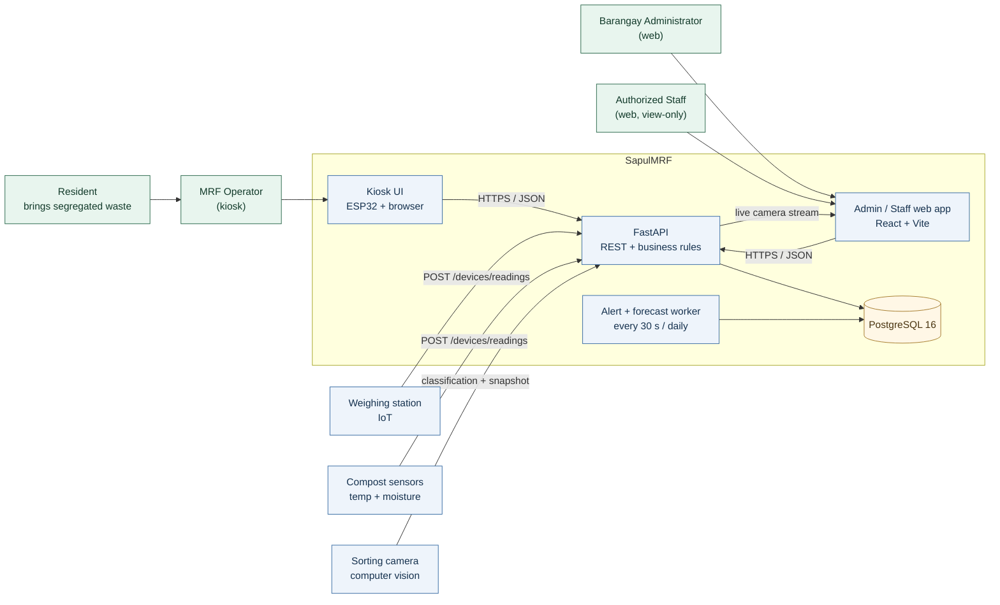

---

## 4. Runtime topology (Docker Compose)

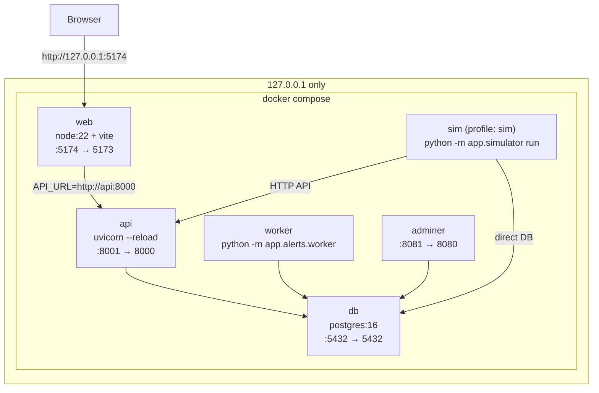

Notes from `docker-compose.yml`:

- `api`, `worker` and `sim` share the image `sapulmrf-api:dev`, built once.
- Source is bind-mounted; `api` reloads only `app/` using polling (Windows file events do not
  cross the mount reliably). This avoids watching `.venv` through Windows file sharing.
- `worker` runs the alert checks every **30 s** and saves the day's forecasts.
- `sim` is behind the `sim` profile and does not start by default.
- All published ports bind to `127.0.0.1`.

---

## 5. Repository map

```
sapulmrf/
├─ api/
│  ├─ app/
│  │  ├─ main.py              app factory + router registration
│  │  ├─ models.py            imports every ORM model (Alembic + tests)
│  │  ├─ simulator.py         fake devices + operator for demos
│  │  ├─ core/                config, db, security, errors, logging
│  │  ├─ auth/ users/ access/ sessions, roles, staff screen grants
│  │  ├─ masterdata/          categories, puroks, materials, areas, buyers
│  │  ├─ devices/             device registry, readings, live camera, kiosk login
│  │  ├─ intake/              drop-offs, scale correction, segregation checks
│  │  ├─ sorting/             camera suggestions, confirmation, stock ledger
│  │  ├─ compost/             batches, readings, activities, wet balance
│  │  ├─ approvals/           recount + outgoing requests, admin review
│  │  ├─ operations/          dashboards over the domain services
│  │  ├─ alerts/              checks, worker loop, alert + problem-report API
│  │  ├─ insights/            flags, forecasts, outlook, schedule
│  │  ├─ reports/             six report kinds, findings, CSV/PDF export
│  │  ├─ corrections/         undo/redo of drop-off, segregation, sorting
│  │  ├─ assistant/           Ask SapulMRF: NLP, slots, answers, guide
│  │  ├─ settings/            single settings row + ranges
│  │  └─ activity/            audit log
│  ├─ tests/                  43 pytest files
│  ├─ alembic/                migrations
│  └─ Dockerfile
├─ web/
│  ├─ src/app/App.tsx         routes and layouts
│  ├─ src/layout/             AdminLayout, OperatorLayout, StaffLayout
│  ├─ src/features/           one folder per screen
│  ├─ src/api/                typed API clients
│  └─ e2e/                    15 Playwright specs
├─ docs/                      roadmap, contracts, runbooks, specs
├─ scripts/                   deploy, backup
├─ docker-compose.yml
├─ start.cmd / stop.cmd
└─ README.md
```

Each API feature follows the same shape: `router.py` (HTTP), `service.py` (rules),
`schemas.py` (Pydantic), `models.py` (tables). Cross-feature reads go through the owning
feature's `service.py`, not its models.

---

## 6. Data model

29 tables, grouped by domain. The ORM imports every model in `api/app/models.py`; Alembic and
the tests rely on that.

### 6.1 Identity, access and audit

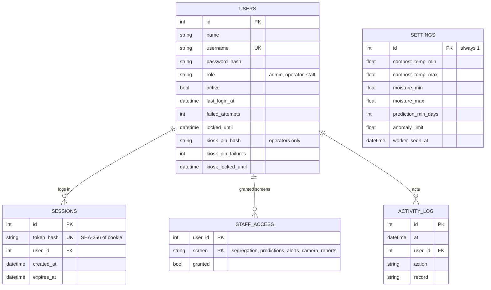

### 6.2 Master data and devices

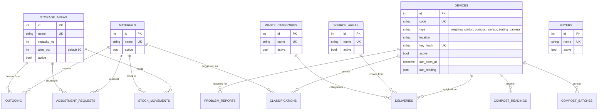

Master data is **deactivated, never deleted**, because later records point at it.

### 6.3 Intake, sorting and storage

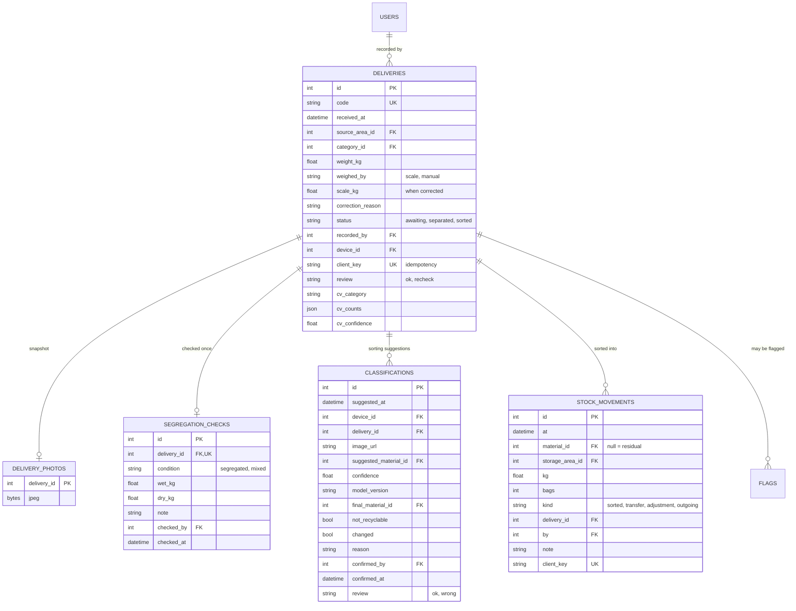

The stock ledger is append-only in spirit: current stock in an area is the **sum of its
movements**, and corrections are written as opposite movements, not by editing history.

### 6.4 Compost, outgoing and governance

```mermaid
erDiagram
    COMPOST_BATCHES ||--o{ COMPOST_READINGS : "sensor data"
    COMPOST_BATCHES ||--o{ COMPOST_ACTIVITIES : "turning, watering, inspection"

    COMPOST_BATCHES {
        int id PK
        string code UK
        datetime started_at
        float start_kg
        int sensor_id FK
        datetime finished_at
        float produced_kg
        int started_by FK
    }
    COMPOST_READINGS {
        int id PK
        int batch_id FK
        int device_id FK
        float temp_c
        float moisture_pct
        datetime read_at
    }
    COMPOST_ACTIVITIES {
        int id PK
        int batch_id FK
        string type "turning, watering, inspection"
        string note
        int by FK
        datetime at
    }
    ADJUSTMENT_REQUESTS {
        int id PK
        int material_id FK
        int storage_area_id FK
        float system_kg
        float actual_kg
        string reason
        string status "pending, approved, rejected"
        int requested_by FK
        datetime requested_at
        int decided_by FK
        datetime decided_at
        string comment
        string review "ok, reversed"
        int reviewed_by FK
        datetime reviewed_at
    }
    OUTGOING {
        int id PK
        string code UK
        string type "sale, compost, disposal, giveaway"
        int material_id FK
        int storage_area_id FK
        float kg
        string recipient
        decimal price_per_kg "sale only"
        decimal total
        string client_key UK
        string status "pending, approved, rejected"
        int requested_by FK
        datetime requested_at
        int decided_by FK
        datetime decided_at
        string comment
        string review "ok, reversed"
        int reviewed_by FK
        datetime reviewed_at
    }
    ALERTS {
        int id PK
        string kind "compost, device, storage"
        int subject_id
        string title
        string details
        datetime opened_at
        datetime resolved_at
        int acknowledged_by FK
        datetime acknowledged_at
    }
    PROBLEM_REPORTS {
        int id PK
        string code UK
        string kind "device, record"
        int device_id FK
        string record_ref
        string details
        int reported_by FK
        datetime reported_at
        string status "open, resolved"
        int resolved_by FK
        datetime resolved_at
        string note
    }
    FLAGS {
        int id PK
        int delivery_id FK
        string kind "weight, gap"
        float value_kg
        float expected_low
        float expected_high
        datetime found_at
        string status "open, valid, incorrect"
        int decided_by FK
        datetime decided_at
    }
    FORECASTS {
        int id PK
        date made_on
        date for_day
        int category_id "0 = all"
        string model "baseline, ml"
        float kg
    }
    CORRECTIONS {
        int id PK
        string kind "sort, segregation, delivery"
        string record_code
        string summary
        string reason
        int by FK
        datetime at
        string redone_as
        string review "ok, wrong"
        int reviewed_by FK
        datetime reviewed_at
    }
    REPORT_EXPORTS {
        int id PK
        string kind
        date from_day
        date to_day
        int area_id FK
        string format "csv, pdf"
        int user_id FK
        datetime created_at
    }
    ASSISTANT_CONVERSATIONS ||--o{ ASSISTANT_MESSAGES : "contains"
    ASSISTANT_CONVERSATIONS {
        int id PK
        int user_id FK
        string title
        datetime created_at
        datetime updated_at
    }
    ASSISTANT_MESSAGES {
        int id PK
        int conversation_id FK
        string role "user, assistant"
        string text
        string intent
        float score
        json slots
        json answer
        bool helpful
        string corrected_intent
        datetime created_at
    }
```

---

## 7. The core material flow

Everything the MRF does moves material through these stages. Each arrow is a table write.

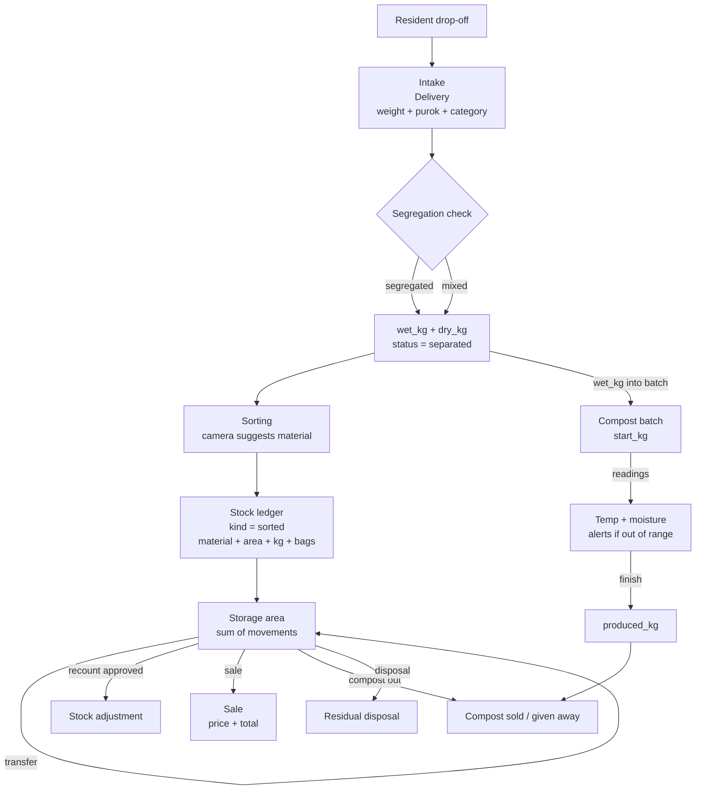

### Where the numbers must add up

| Invariant | Rule | Code |
|---|---|---|
| Delivery weight | `weight_kg > 0` | `api/app/intake/models.py` |
| Segregation split | `wet_kg + dry_kg` may not exceed `weight_kg × 1.10 + 0.5 kg`; it may be less if some waste is unaccounted for | `api/app/intake/service.py:135` |
| Sorted quantity | total sorted kg may not exceed the check's `dry_kg × 1.10` | `api/app/sorting/service.py:17,157` |
| Wet balance | `Σ segregation.wet_kg − Σ batch.start_kg`, never below 0 | `api/app/compost/service.py:35` |
| Batch start | cannot exceed balance + **0.5 kg** slack | `api/app/compost/service.py:32,50` |
| Outgoing kg | `kg > 0` and cannot exceed available stock in that area/material | `api/app/approvals/service.py` |
| Sale | `price_per_kg` required, `total = kg × price` | `api/app/approvals/service.py` |
| Purchases | no price on giveaway; optional on compost; required on sale | `api/app/approvals/models.py` |
| Storage alert | area is an alert when `pct ≥ alert_pct` (default 90%) | `api/app/insights/service.py` |

---

## 8. Workflows in detail

### 8.1 Intake (drop-off)

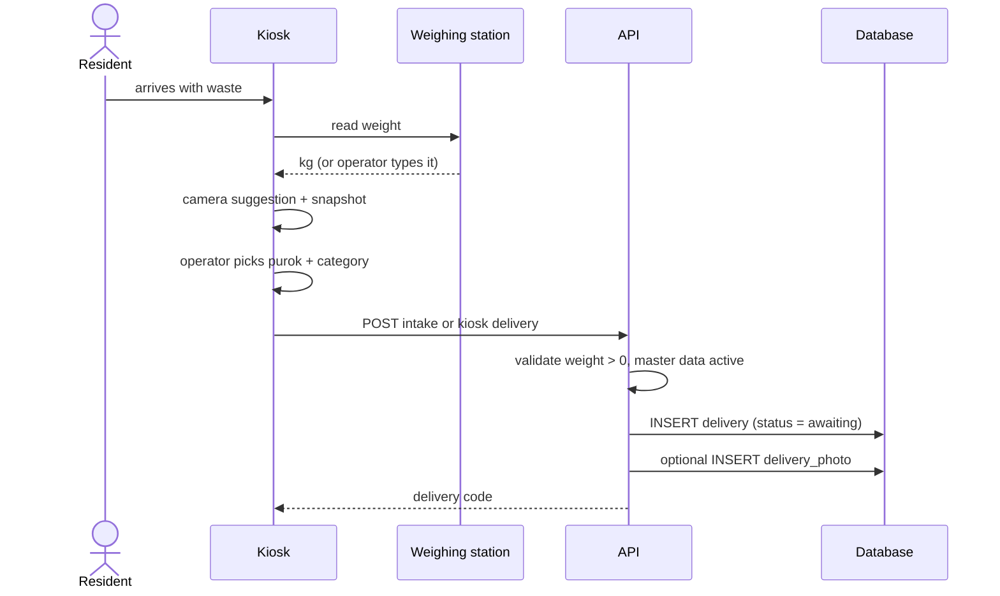

Rules:

- `weighed_by` is `scale` or `manual`. A manual override stores the original `scale_kg` and a
  `correction_reason` beside the accepted `weight_kg`.
- A `client_key` makes the write idempotent: a retried request returns the first delivery
  instead of creating a duplicate (`api/app/intake/service.py:73`).
- The kiosk camera's guess is stored as `cv_category`, `cv_counts`, `cv_confidence` **next to**
  the resident-confirmed category. It never overwrites the human choice.
- Photos live in `delivery_photos` so delivery lists never load image bytes.

### 8.2 Segregation check

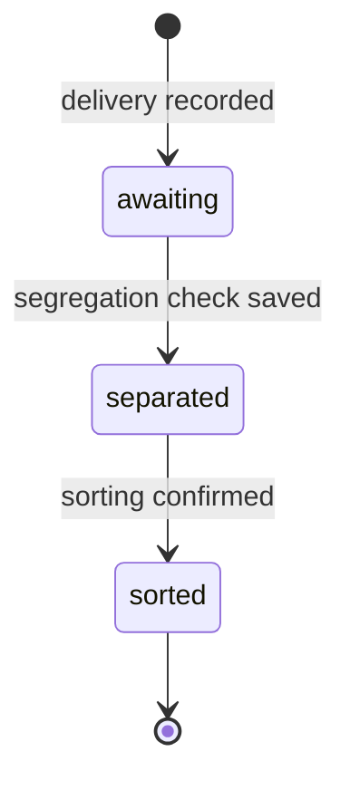

The check stores:

- `condition`: `segregated` or `mixed`
- `wet_kg` (biodegradable, goes to compost) and `dry_kg` (recyclable/residual)
- a free-text `note`, the checker, and the time

Compliance is `segregated / checked`. It is the backbone of the segregation report and of the
"lowest-compliance purok" finding.

### 8.3 Sorting and computer vision

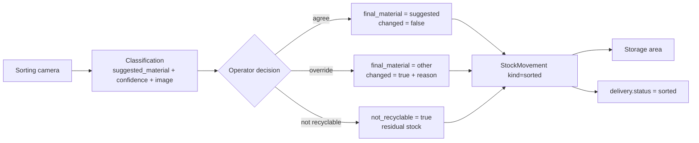

- One classification row records the suggestion, the decision, who confirmed it, and when.
- The admin can later mark a change `ok` or `wrong` (`review`). This is an audit mark only; it
  does not rewrite the ledger.
- Sorting writes a positive `stock_movements` row. Transfers write a **negative** row at the
  source and a **positive** row at the destination, sharing a `client_key` on the source row so
  a retry cannot duplicate a move.

### 8.4 Storage and inventory

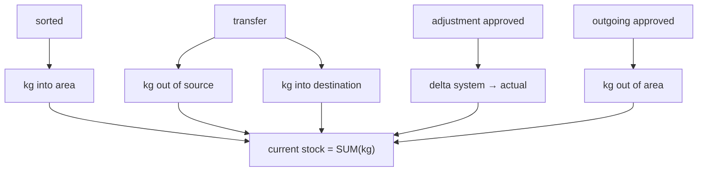

Inventory screens show, per area and material: current kg, bags, capacity, fill percent, and
days-to-full at the current pace. A recount is an `AdjustmentRequest`; it changes stock only
when approved.

### 8.5 Composting

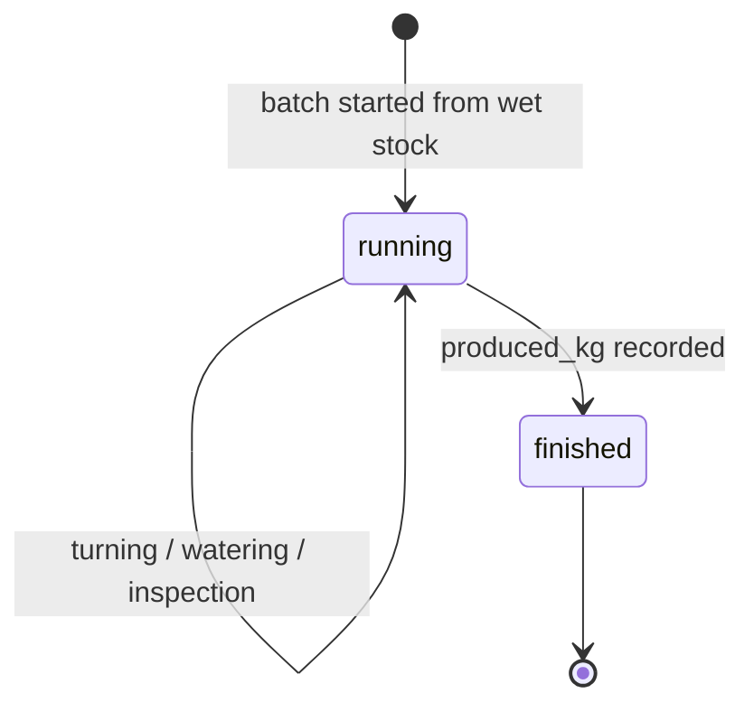

- A batch consumes `start_kg` from the **wet balance** (segregated wet minus batches already
  started), with 0.5 kg rounding slack.
- Readings are unique per `(device_id, read_at)`; a retried device reading does not duplicate.
- The worker compares readings with the settings ranges (temperature and moisture) and opens a
  `compost` alert after the condition persists (`COMPOST_WAIT = 10 min`).
- Compost is logged by hand (no yield sensor). The finished batch records `produced_kg`; the
  report computes yield as `produced / start`.

### 8.6 Outgoing material

Four kinds, each with different money rules:

| Kind | Price | Typical recipient | Ledger effect |
|---|---|---|---|
| `sale` | required | junkshop / buyer | stock decreases, income increases |
| `compost` | optional | purok garden | stock decreases, optional income |
| `giveaway` | none | purok garden / resident | stock decreases, no income |
| `disposal` | none | ENRO truck / landfill | stock decreases, counted as residual |

See `docs/superpowers/specs/2026-11-15-give-away-design.md`.

### 8.7 Reviews, approvals and reversals

The kiosk operator acts first; the admin audits afterwards. There are five review surfaces:

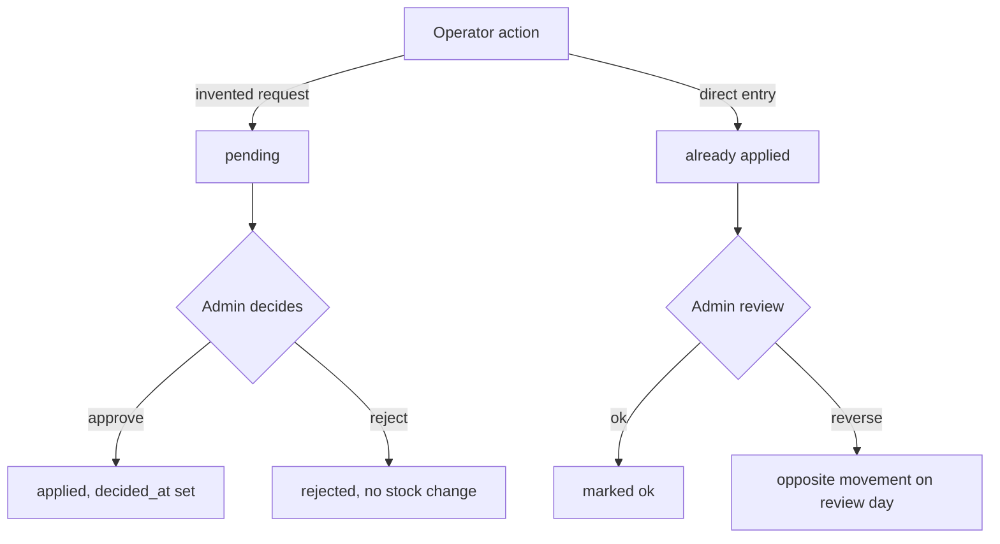

| Surface | Table | Operator's entry | Admin's mark |
|---|---|---|---|
| Recount / adjustment | `adjustment_requests` | `pending` request | approve/reject, then `ok`/`reversed` |
| Outgoing | `outgoing` | `pending` for sale/disposal; applied for quick kiosk entries | approve/reject, then `ok`/`reversed` |
| Corrected weight | `deliveries` | `scale_kg` + reason | `ok`/`recheck` |
| Changed classification | `classifications` | `changed` + reason | `ok`/`wrong` |
| Undone record | `corrections` | undo with reason | `ok`/`wrong` |

Reversal semantics:

- Reversing an outgoing return the kg to stock **on the day it was reversed**, and subtracts the
  sale amount from income on that same day. This keeps each day's report internally consistent
  and avoids rewriting closed periods (`api/app/operations/service.py`).
- Reversing an adjustment writes the opposite stock movement.
- Reversal never deletes the original row.

### 8.8 Corrections (undo / redo)

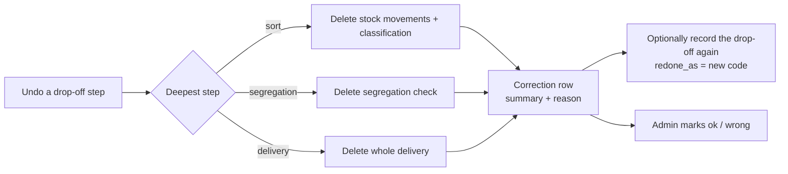

- Undone rows are gone; `summary` preserves what they said.
- An operator can undo only **today's** records (Asia/Manila). The admin can undo any day.
- `redone_as` links a correction to the replacement drop-off, so a mistake and its fix are
  auditable as one story.

### 8.9 Alerts and problem reports

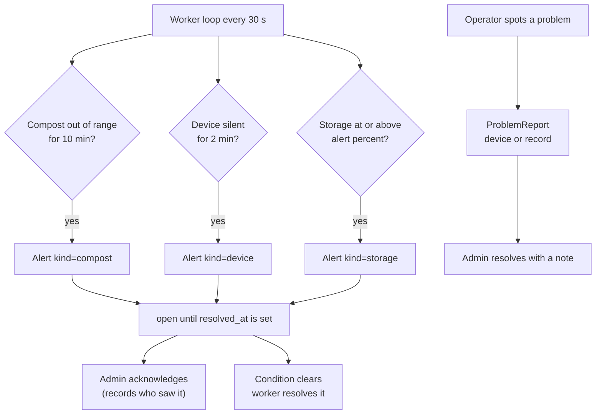

- One open alert per `(kind, subject_id)` is enforced by a partial unique index, so two workers
  cannot duplicate an alert.
- Acknowledging is not resolving. The alert stays open until the condition clears.
- Device silence threshold is 2 minutes (`api/app/devices/service.py`).
- Alerts worker interval is 30 s; the day's forecast catch-up also runs there.

### 8.10 Insights: flags, forecasts and outlook

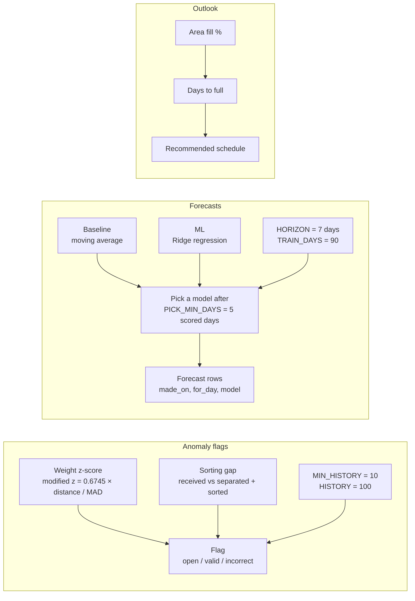

Flags (`api/app/insights/flags.py`):

- Modified z-score: `0.6745 × distance / MAD`, robust to outliers.
- A purok needs **10 earlier deliveries** before its weights are judged; the most recent **100**
  define "usual".
- A `gap` flag fires when received weight and the segregation+sorting total disagree by more
  than `GAP_PCT = 5%` or `GAP_KG = 0.3 kg`.
- Flags **never mutate records**. Undecided flags expire after 14 days.

Forecasts (`api/app/insights/forecast.py`):

- `HORIZON = 7`, `TRAIN_DAYS = 90`, `CATCH_UP_DAYS = 14`.
- Two models: `baseline` (moving average) and `ml` (Ridge). Ridge needs at least
  `RIDGE_MIN_DAYS = 28` days; a model needs `PICK_MIN_DAYS = 5` scored days before it can be
  chosen.
- Forecasts are scoring-free: they are stored as predictions, and accuracy comes from comparing
  them with actuals later. The worker catches up one forecast per Manila day.
- `category_id = 0` means all waste together.

Outlook and schedule add operational advice: which area is near capacity, how many days until
full, and what to do next.

### 8.11 Reports

Six kinds (`api/app/reports`): `intake`, `segregation`, `inventory`, `composting`, `outgoing`,
`income`.

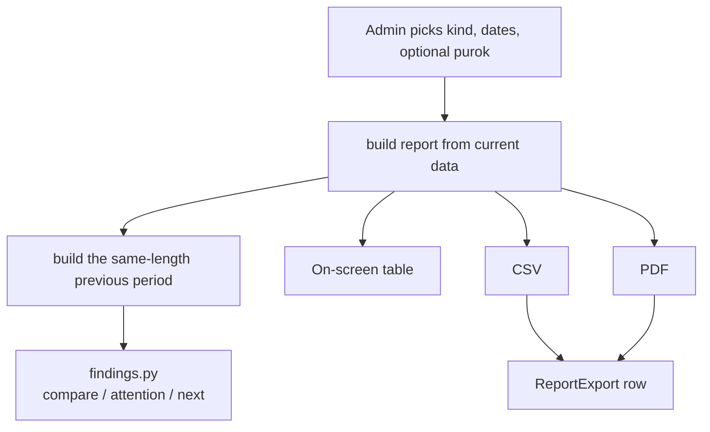

Findings (`api/app/reports/findings.py`) are deterministic sentences derived from the report
rows:

- **compare** — totals and compliance versus the previous period.
- **attention** — lowest-compliance purok, areas at/over alert level or full soon, open unusual
  deliveries, residual disposal over half of outgoing.
- **next** — suggested action (review flags, plan a reminder/visit, check sorting).

Every number on the page, in the PDF and in the CSV comes from the same computed `Report`, so
the three outputs cannot disagree. Exports are not stored; Download rebuilds the file from
current data and logs a `ReportExport` row.

### 8.12 Ask SapulMRF (assistant)

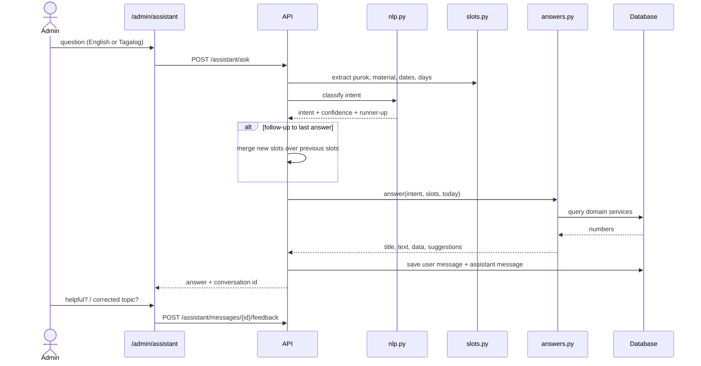

Intents: `today`, `intake`, `segregation`, `storage`, `compost`, `outgoing`, `income`,
`forecast`, `unusual`, `attention`, `camera`, `help`, `smalltalk`, `guide`.

How it works:

- **Intent**: TF-IDF (character 3–5 grams + word 1–2 grams) into a balanced logistic regression
  trained on `examples.json`, plus the guide's own questions. `THRESHOLD = 0.30`; below
  `SURE = 0.45` the answer also offers "Not what you meant?" with the runner-up.
- **Slots**: dates (`kahapon`, `last week`), purok names, storage areas, materials, categories,
  and day counts, normalized from the live master data. Unknown names produce an honest "No
  Purok 99."
- **Follow-ups**: "and purok 4?", "e kahapon?" inherit the previous intent and slots; naming a
  new place replaces all old places so a stale note does not leak.
- **Guide**: "how do I…", "what does … mean", "where is …" match curated `guide.json` entries
  with character n-grams, so typos and Tagalog affixes still match. Each entry returns steps and
  a deep link.
- **History**: private per admin, persisted in `assistant_conversations` / `assistant_messages`.
  Answers are stored as shown, so history stays truthful.
- **Feedback**: `helpful` and `corrected_intent` are recorded for retraining.
- **No LLM, no file uploads.** The assistant answers with computed numbers only.

### 8.13 Authentication, roles and the kiosk

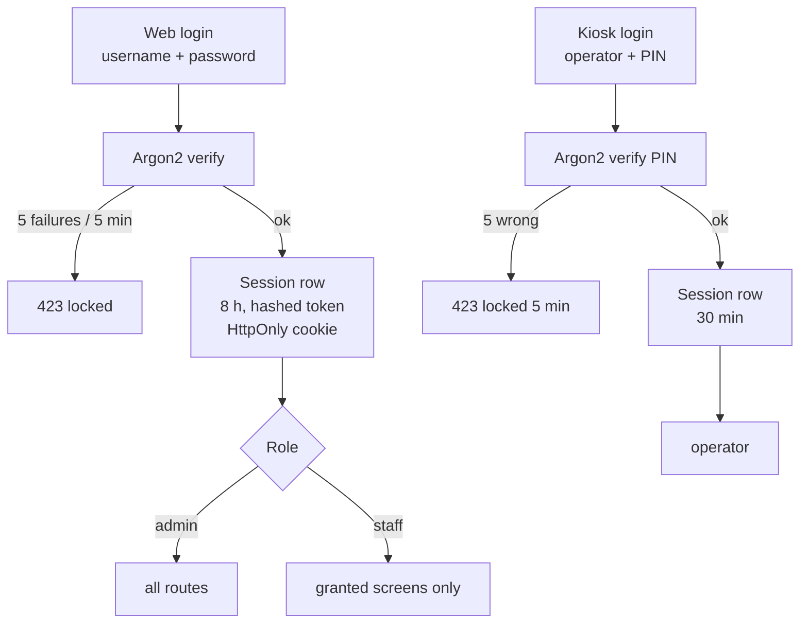

- Roles: `admin` (everything), `operator` (kiosk and own records), `staff` (view-only).
- Staff screens are per-user grants in `staff_access`: `segregation`, `predictions`, `alerts`,
  `camera`, `reports`.
- Passwords and kiosk PINs are Argon2. Sessions store only a SHA-256 of the cookie token.
- Login lockout after 5 failures for 5 minutes; kiosk PIN lockout after 5 failures for 5 minutes.
- Kiosk sessions are short (30 min) because the kiosk is in a public place.
- Every meaningful action writes an `activity_log` row.

### 8.14 Devices and the IoT contract

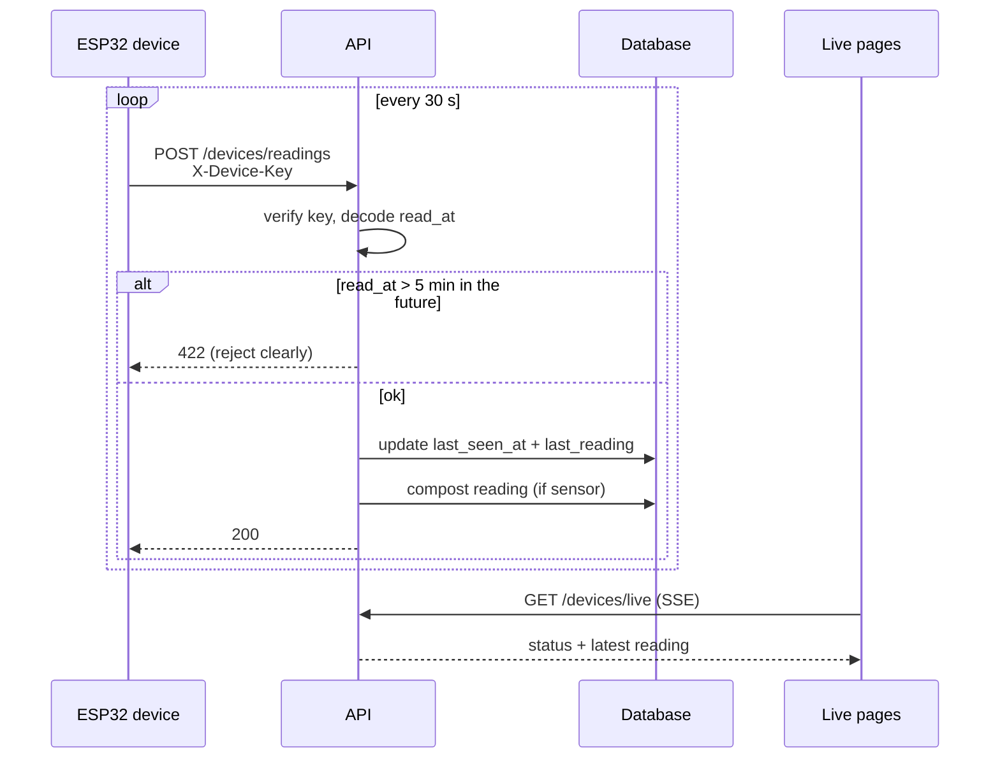

- Authentication is a shared `X-Device-Key` header; the server stores only its hash.
- `read_at` is optional and timezone-aware; more than 5 minutes in the future is rejected with
  `422` rather than silently clamped.
- Offline is derived, not stored: no reading for 2 minutes.
- Firmware buffers about 500 readings in RAM and retries with backoff.
- Device types: `weighing_station`, `compost_sensor`, `sorting_camera`.
- Full contract: `docs/device-contract.md`.

---

## 9. Lifecycle summary

### Delivery

```mermaid
stateDiagram-v2
    [*] --> awaiting: intake
    awaiting --> separated: segregation check
    awaiting --> awaiting: weight corrected
    separated --> sorted: sorting confirmed
    sorted --> [*]
    awaiting --> [*]: undone (today / any day for admin)
```

### Outgoing / adjustment

```mermaid
stateDiagram-v2
    state "pending" as P
    state "approved (applied)" as A
    state "rejected" as R
    [*] --> P: operator request
    P --> A: admin approves
    P --> R: admin rejects
    A --> A: admin review ok
    A --> [*]: admin reverses (opposite movement)
    R --> [*]
```

### Alert

```mermaid
stateDiagram-v2
    [*] --> open: condition found
    open --> open: acknowledged (who saw it)
    open --> resolved: condition clears
    resolved --> [*]
    open --> [*]: manually resolved with note
```

### Correction

```mermaid
stateDiagram-v2
    [*] --> recorded: undo with reason
    recorded --> recorded: redone_as linked
    recorded --> ok: admin marks ok
    recorded --> wrong: admin marks wrong
    ok --> [*]
    wrong --> [*]
```

---

## 10. Business rules cheat sheet

| Area | Rule |
|---|---|
| Time | All day boundaries, reports and "today only" use `Asia/Manila` |
| Intake | Weight must be > 0; master data must be active; `client_key` prevents duplicates |
| Segregation | One check per delivery; `wet_kg + dry_kg` matches the delivery within scale rounding |
| Sorting | Camera is advisory; operator's final material is what stock records |
| Stock | Current kg = sum of ledger rows; no deletes, only opposite movements |
| Transfer | Negative source row + positive destination row, linked by `client_key` |
| Compost | Batch cannot exceed wet balance + 0.5 kg; readings unique per device + timestamp |
| Outgoing | Cannot exceed available kg; sale requires price; giveaway has none |
| Reviews | Reversal applies on the review day, never rewrites a closed day |
| Corrections | Operator: today only; admin: any day; reason required; original rows gone, summary kept |
| Flags | Advisory only; never mutate the record; undecided expire after 14 days |
| Forecasts | Stored predictions; chosen model needs 5 scored days; Ridge needs 28 training days |
| Alerts | One open alert per subject; ack does not resolve; auto-resolve when condition clears |
| Sessions | Web 8 h; kiosk 30 min; lockout 5 tries / 5 min |
| Audit | Every meaningful action is logged; exports are logged but files are rebuilt on demand |
| Deletion | Master data and users are deactivated; historical rows stay |

---

## 11. API surface

Registered in `api/app/main.py`:

| Prefix | Responsibility |
|---|---|
| `/auth` | web login/logout/me |
| `/users` | admin user management, kiosk PINs |
| `/access` | staff screen grants |
| `/activity` | audit log |
| `/masterdata` | categories, puroks, materials, storage areas, buyers |
| `/devices` | registry, readings, live SSE, kiosk login |
| `/settings` | ranges and limits |
| `/intake` | deliveries, segregation checks |
| `/sorting` | suggestions, confirmation, transfers, stock |
| `/compost` | batches, readings, activities, finish |
| `/operations` | overview, inventory, outgoing views, camera, metrics |
| `/approvals` | recount and outgoing requests, decisions, reviews |
| `/alerts` | alerts, acknowledgements, problem reports |
| `/insights` | flags, forecasts, outlook, schedule |
| `/reports` | preview, export (CSV/PDF), export history |
| `/corrections` | undo/redo and their reviews |
| `/assistant` | ask, conversations, feedback, suggestions |
| `/health` | liveness, worker heartbeat, DB check |

---

## 12. Frontend navigation

```mermaid
flowchart LR
    login["/login"] --> admin["/admin"]
    login --> operator["/op"]
    login --> staff["/staff"]

    admin --> overview["Overview"]
    admin --> approvals["Approvals"]
    admin --> alerts["Alerts"]
    admin --> operations["Operations"]
    operations --> intake["Intake"]
    operations --> segregation["Segregation"]
    operations --> sorting["Sorting"]
    operations --> inventory["Inventory"]
    operations --> compost["Compost"]
    operations --> outgoing["Outgoing"]
    operations --> camera["Live camera"]
    admin --> insights["Insights"]
    admin --> reports["Reports"]
    admin --> assistant["Ask SapulMRF"]
    admin --> settings["Settings"]

    operator --> optoday["Today"]
    operator --> opdrop["Intake"]
    operator --> opsort["Sort"]
    operator --> opstore["Storage"]
    operator --> opmore["More"]
    opmore --> opseg["Segregation"]
    opmore --> opcompost["Compost"]
    opmore --> opout["Outgoing"]
    opmore --> opalerts["Alerts"]
    opmore --> ophist["History"]
    opmore --> opprofile["Profile"]

    staff --> stover["Overview"]
    staff --> strec["Records"]
    staff --> strep["Reports"]
    staff --> stnotif["Notifications"]
```

The admin sidebar badges show pending approvals and open alerts. Kiosk routes live under
`/op` (five bottom tabs, with the rest behind More); staff routes under `/staff`. The five
grantable staff areas (`segregation`, `predictions`, `alerts`, `camera`, `reports`) gate what
the staff pages expose rather than adding more top-level routes.

---

## 13. Tests

| Suite | Where | Count | How to run |
|---|---|---|---|
| API (pytest) | `api/tests/*.py` | 43 files / 359 cases | `docker compose exec api pytest` |
| Browser (Playwright) | `web/e2e/*.spec.ts` | 15 specs / 35 tests | `cd web; npm run test:e2e` |

Coverage highlights by file:

- Rules: `test_intake`, `test_sorting`, `test_compost_balance`, `test_compost_and_devices`,
  `test_approvals`, `test_reviews`, `test_review_fixes`, `test_corrections`, `test_giveaway`,
  `test_outgoing_now`, `test_outgoing_view`, `test_recount_now`.
- Insights: `test_flags`, `test_forecast`, `test_insights_api`, `test_alerts_api`,
  `test_alert_checks`.
- Devices: `test_devices`, `test_devices_live`, `test_device_readings`, `test_simulator`.
- Assistant: `test_assistant_nlp`, `test_assistant_slots`, `test_assistant_answers`,
  `test_assistant_guide`, `test_assistant_routes`.
- Governance and safety: `test_auth`, `test_users`, `test_access`, `test_security`,
  `test_data_safety`, `test_activity`, `test_health`, `test_reliability`.
- Reports: `test_reports`.

The suite is organized around behavior, not files: each test file is a story about one feature.

---

## 14. Running and operating

```mermaid
flowchart LR
    start["start.cmd"] --> up["docker compose up -d"]
    up --> wait["wait for health"]
    wait --> open["http://127.0.0.1:5174"]
    sim["start.cmd sim"] --> profile["docker compose --profile sim up -d sim"]
    stop["stop.cmd"] --> down["docker compose down"]
```

- Daily use: `start.cmd`, then open `http://127.0.0.1:5174`. `stop.cmd` stops the stack.
- Demo data: `start.cmd sim` (or the commands in `sim/README.md`).
- Backups: daily at 02:00 Manila in production (`docs/deployment.md`).
- Migrations: Alembic in `api/alembic`; run inside the API container.
- Production: Caddy terminates HTTPS; the same API/worker/web images are used.

Simulator (`api/app/simulator.py`):

| Command | Effect |
|---|---|
| `python -m app.simulator setup` | creates `sim.operator` + `SIM-` devices, saves credentials |
| `python -m app.simulator backfill --days 40` | 40 days of deliveries, readings, forecasts, decisions |
| `python -m app.simulator run` | live loop: deliveries, readings, camera, occasional disturbances |
| `python -m app.simulator remove` | deletes only simulated data |

The simulator deliberately creates outliers, sorting gaps, Saturday sales, recounts, and
sensor dropouts so every screen has something real to show.

---

## 15. Current status and known boundaries

Implemented and tested:

- Full intake → segregation → sorting → storage → compost → outgoing lifecycle.
- Kiosk operator flows with PIN sign-in and today-only correction window.
- Admin reviews: recounts, outgoing, corrected weights, changed classifications, undone records.
- Alerts worker, problem reports, live device status and camera stream.
- Flags, 7-day forecasts with two models, area outlook and schedule.
- Six reports with deterministic findings and CSV/PDF export history.
- Ask SapulMRF with follow-ups, feedback, and a curated guide.
- Staff view-only screens gated per user.
- Simulator and 40-day backfill for demos.

Deliberate boundaries:

- The assistant is not generative AI; it retrieves and explains computed data.
- Camera classification is advisory, and training the CV model is outside this repository
  (the kiosk/firmware repo owns the capture side).
- IoT devices push over HTTP; there is no MQTT broker.
- Compost yield is entered by hand, not measured.
- Single-barangay deployment; no multi-tenant support.

See `docs/roadmap.md` for the requirement map (ADM-01…21) and phase plans.

---

## 16. Glossary

| Term | Meaning |
|---|---|
| **MRF** | Materials Recovery Facility |
| **Purok** | Barangay sub-area; the source of deliveries (`source_areas`) |
| **Wet waste** | Biodegradable fraction; feedstock for compost |
| **Dry waste** | Recyclable + residual fraction |
| **Segregation** | Splitting a delivery into wet and dry |
| **Sorting** | Choosing the recyclable material of the dry fraction |
| **Residual** | Non-recyclable remainder; `material_id = null` in stock |
| **Wet balance** | Segregated wet kg minus wet kg already started in batches |
| **Recount** | Operator's physical stock count that differs from the ledger |
| **Reversal** | Admin undoing an applied record on the day of review |
| **Correction** | Undo of a drop-off step, with a reason and an optional redo |
| **Flag** | Advisory anomaly marker; never changes the record |
| **Finding** | Plain-language sentence computed from a report's own rows |
| **Baseline / ML** | The two forecast models; a moving average and a Ridge regression |
| **Kiosk** | The operator-facing device at the MRF |
| **SSE** | Server-Sent Events, used for live device status |
